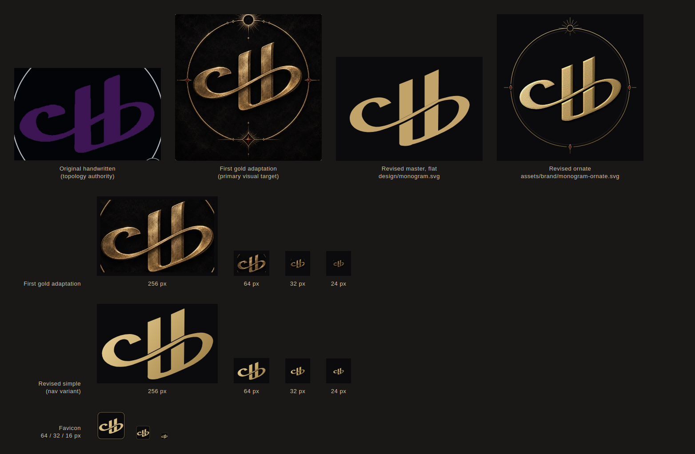

# Monogram review — revision 2

The revision 1 trace was rejected: it followed the handwritten original too
literally and looked thick, blunt and simplified next to the approved gold
adaptation. Revision 2 discards that geometry and rebuilds the mark with
this precedence:

1. **First gold adaptation:** the primary visual target.
2. **Original handwritten mark:** letterform relationships and crossing
   topology.
3. **Eclipsing Eden boards:** surface treatment, ornament and palette.

`proof/monogram-comparison.png` (device pixels 1:1) and
`proof/monogram-comparison-2x.png` (as a high-density screen shows them)
contain:

- **Row 1:** the original handwritten mark; the first gold adaptation; the
  revised master (flat); the revised ornate treatment.
- **Rows 2–3:** the gold adaptation and the revised nav mark side by side at
  **256, 64, 32 and 24 px** wide, on the site's void background.
- **Row 4:** the favicon at 64, 32 and 16 px.

Regenerate with `docker compose --profile tools run --rm art python3 tools/art/monogram_sheet.py`.

## Files

| File | Purpose |
| --- | --- |
| `design/monogram.svg` | **Editable master.** Coordinates are in the gold adaptation's 1254 px pixel space, so the reference drops underneath at (0,0). The layers are `#stems` (two paths), `#swoop` (one path, 26 nodes), the `#crossing-gap` mask and the `#crossing-zone` clip. A node plan in the file header names every segment. No ornament. |
| `assets/brand/monogram-simple.svg` | Nav, divider and footer mark. **Same paths as the master**, with two small-size adjustments: a 6-unit self-coloured outline (adds weight to the 20-unit band and return stroke) and a wider crossing gap. |
| `assets/brand/favicon.svg` | The simple mark with a heavier outline and gap, on a void tile. |
| `assets/brand/monogram-ornate.svg` | Large placements. Same paths as the master, plus: a hammered-gold filter (specular bevel lit from the upper left, plus fractal texture); the shaded side faces of the stems, as in the gold adaptation; and a cast shadow. The ring, sunburst zenith and blood-red diamond stations are a separate `#ornament` group. |

## How the geometry was rebuilt

1. **Measuring.** `tools/art/profile.py` prints the gold mark's filled runs
   along rows and columns. Those runs gave exact edge positions:
   - stem tops and slants;
   - band thickness (about 20 units through the crossing);
   - the counters' extents;
   - the c terminal's beak.
2. **Hand-placed nodes.** Each segment of the master was then placed by hand
   against those measurements, with as few nodes as the curve needs.
3. **Overlay check.** `tools/art/overlay.py` checked the result against the
   reference. Gold means both agree, magenta means the reference only, cyan
   means the vector only. See `proof/monogram-overlay.png`.

The overlay was a tracing aid, not the acceptance test. Each pass was judged
on the comparison sheet at real sizes.

### What now follows the gold adaptation

- **The c.** A calligraphic c whose top arm ends in a hooked, beak-shaped
  terminal, with a heavy left bowl (about 80 units) thinning into the band.
- **The band.** Slender and even (about 20 units), rising in front of both
  stems at the adaptation's angle.
- **The loop.** It thickens through its right side and encloses a
  teardrop-shaped counter.
- **The return stroke.** Slim, it runs back beneath the stems. It closes a
  tall U-shaped counter and ends in a rounded foot under the first stem.
- **The stems.** Both are tall, with broad-nib tops that slant up to the
  right. The second stem is taller.
- **The crossing.** The swoop passes **in front of both stems**. A masked gap,
  offset slightly down and right, reads as the band's cast shadow, as in the
  gold adaptation. It is real geometry, so it works on any background,
  including transparency. The gap applies only inside `#crossing-zone`, so the
  return stroke stays fused to the stems' feet.

### What still follows the original

The topology is the original's:

- one continuous ribbon: c → band → loop → return → foot;
- the band crossing over both stems;
- the U-counter between the stems.

## Legibility at real sizes

| Size | Result |
| --- | --- |
| 256 px | Every feature reads: the hooked terminal, the band crossing in front of both stems, the loop counter and the U counter. |
| 64 px (the nav medallion uses about 50–66 px) | It reads clearly as the gold adaptation's mark. The crossing is visible on both stems. |
| 32 px | The silhouette, both counters and the crossing remain. The band is a little over 1 px, carried by the small-size outline. |
| 24 px | It is recognisable as the mark. The crossing reads as a break in the stems rather than a distinct band. |
| 16 px (favicon) | Silhouette only. The crossing is lost. A pixel-hinted 16 px favicon remains a follow-up. |

## Remaining differences from the gold adaptation

These are deliberate:

- **Flat colour at small sizes.** The nav and favicon variants are a flat
  gold gradient with no bevel or texture, because a bevel turns to mud below
  about 100 px.
- **No raster tooling marks.** The adaptation's hammered metal is
  approximated by an SVG filter in the ornate variant, not a bitmap.

This is unfinished:

- **The ornate variant's metal finish.** It is brighter and smoother than the
  adaptation's darker, aged, coarsely hammered gold. The filter parameters
  are easy to tune once the owner approves the geometry.

## Where it is used (remediation 2)

**Status: provisionally accepted by the owner; geometry frozen for Phase 00.**

- Navigation medallion only (`monogram-simple.svg`, `` inside a
  link labelled "Tyler Baum — home"), plus the favicon.
- Removed from beneath the name (replaced by an Art Deco rule with a
  diamond) and from the footer (replaced by a small diamond-and-rule
  ornament), so the signature is never repeated. Enforced by a smoke test
  and a browser check.
- The ornate variant is not on the page; it remains available for large
  placements such as a social card.
