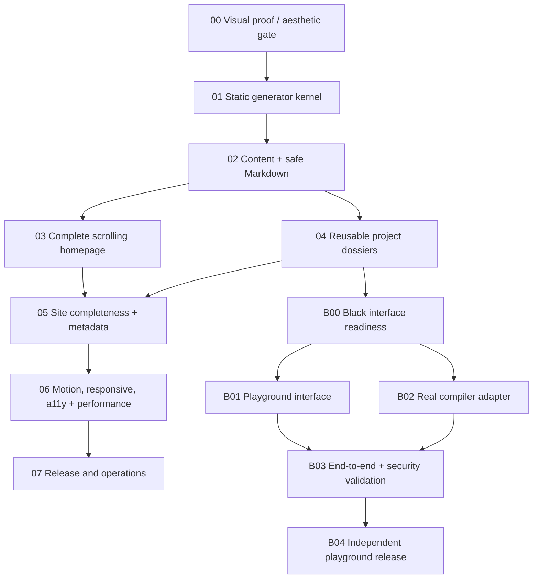

# Personal Technical Folio — Phase-Ordered Implementation Plan

**Version:** 1.0  
**Date:** 2026-11-14  
**Status:** Ready for Phase 00  
**Authority:** `personal-portfolio-prd.md` (v1.0, 2026-11-14)  
**Approach:** Static-first, visual-proof-first, gated phases, independent Black playground release.

---

## 0. Executive decisions

We are building **one cohesive dark Art Deco noir portfolio**: a cinematic, scrollable homepage inspired by the *second* approved website render, and modular technical project dossiers inspired by the *third*. The original handwritten `tb` monogram is adapted using the *first* gold logo render, preserving the **swoop in front of the vertical stems**.

The public site is statically generated by a **small, purpose-built Haskell executable using Brigid**. Project metadata is portable structured data; articles and longer project narratives may be Markdown, parsed by an existing lightweight CommonMark implementation. There is **no Hakyll, Pandoc, generic SSG, database, application server, or full-page client framework**. Visual effects use CSS, SVG, optimized images, and small TypeScript modules.

**Portfolio v1 can launch without a live Black compiler.** The homepage features only a Black teaser. The full editor belongs exclusively on `/work/black/` and is a separately gated release that must use the real compiler and authentic human and structured JSON diagnostics.

This plan intentionally splits work into bounded phases whose results are demonstrable. **Phase 00 is a visual acceptance gate**, not permission to scaffold the entire application with generic placeholders.

### Sources of truth and precedence

1. **Product, functional, and release scope:** `personal-portfolio-prd.md`.
2. **Homepage composition:** second render, `a_detailed_cinematic_dark_art_deco_portfolio_webs.png`.
3. **Project-page composition:** third render, `a_detailed_high_resolution_cinematic_website_hom.png`.
4. **Brand treatments:** `eclipsing-eden-art.zip`, specifically `01_branding/` boards and accompanying art-style guidance. **Ignore playable-race art.**
5. **Monogram shape:** the original handwritten logo `image(20261111-163124).png`; the **first** Art Deco adaptation is the closest stylistic precedent. Do not substitute an unrelated `TB` wordmark.

If aesthetic and engineering convenience conflict, first look for a simpler technical implementation of the approved visual idea. Do not silently downgrade the identity. If an approved design is infeasible at acceptable performance or accessibility, document and present the tradeoff at the relevant gate.

### Global nonnegotiables

- Dramatic arrival; subsequent sections quieter and readable.
- Semantic, accessible, responsive HTML; navigation and core content work without JavaScript.
- Accurate project claims, verifiable evidence, and clear implemented/in-progress/planned status.
- No homepage compiler; no simulated public Black compiler or fabricated compiler output.
- No dedicated backend for the static portfolio; no public arbitrary native code execution.
- Local Haskell builds and scripted local deployment; **no cold GHC/Brigid/Pandoc-equivalent build on free CI runners**.
- Minimal dependencies and small code surface; no general-purpose framework written as a side quest.
- Preserve the same routes, content, CSS/SVG, and asset contracts for a possible future Black-based generator.

---

## 1. Dependency graph and release tracks



**Mainline launch path:** `00 → 01 → 02 → (03 and 04) → 05 → 06 → 07`. The homepage (03) and dossiers (04) can be worked on independently after content infrastructure is stable, but both must pass before integration (05).

**Black track:** The Black dossier exists at launch as an honest, informational project page. The playground is optional for Portfolio v1; it does **not** gate phases 05–07. B00–B04 should only proceed as Black's actual compiler capabilities permit. It is acceptable for this track to begin after the portfolio is live.

### Work-item states

Use `not started / in progress / blocked / gate passed` for phases. A phase passes only with artifacts and independently inspectable evidence, not merely an implementer's assertion that it is finished.

### Common definition of done for every phase

1. Required outputs exist in version control in the agreed locations.
2. Explicit acceptance checks pass; commands and results are recorded.
3. No unfinished placeholder content is presented as working functionality.
4. No new unreviewed dependency or design-system deviation.
5. A short retrospective records what changed, evidence, limitations, and precise follow-on dependencies.
6. Visual changes receive desktop and mobile screenshots and are compared with approved references.

---

## 2. Phase 00 — Visual proof (hard gate)

**Purpose:** Prove we can reproduce the *character*, not merely the colors, of the approved Art Deco design in a responsive browser. **Start here.**

**Dependencies:** PRD and provided visual references only. No Haskell generator, Markdown parser, browser framework, or live Black compiler required.

### Work

**00.1 Curate reference material**
- Collect the exact homepage and dossier reference renders, the original handwritten monogram, the selected **first** gold adaptation, and the relevant Eclipsing Eden branding boards into a *design-reference directory* for local work.
- Do not import the whole Eclipsing Eden archive or playable-race imagery into the website repository.
- Record which visual motifs are being adopted (eclipse, architecture, engraved serif, delicate border geometry) and which are deliberately excluded (lore, characters, heavy occult props, overly ornate cards).
- Ensure any shipped font or illustration has a suitable license; do not assume generated images are optimized production assets.

**00.2 Define a minimal visual system**
- Tokens for void `#0B0B0D`, aged gold `#C2A46A`, bone `#E7E2D2`, blood `#7A0E14`, verdigris `#51796B`, plus functional surfaces, muted text, borders, focus, and hover colors.
- Select and locally validate a display serif, readable body face, and monospace face. Check licensing, availability, fallback behavior, and text contrast before adopting.
- Set typography scale, container widths, spacing, corner/cartouche style, border weights, and texture treatment. Use restrained ornament: hero can be magnificent; ordinary content cannot be constantly framed like a title card.
- Establish basic responsive rules and reduced-motion behavior.

**00.3 Reconstruct the monogram**
- Trace or redraw the original monogram as an editable vector, preserving its **recognizable hand-drawn silhouette** and **the crossing swoop placed visibly in front of both stems**.
- Create a minimal one-color version for small navigation/favicon sizes and an ornamental version for larger compositions. Decorations must be removable without destroying the core mark.
- Compare against the original at large size and at favicon scale. Avoid treating image-generation approximations as mechanically accurate vector masters.

**00.4 Build one browser-visible vertical slice**
- Responsive header/nav; theatrical hero with **name, role, thesis, two CTAs**, eclipse/architectural treatment, and appropriately layered atmosphere.
- One finished project card and the divider/transition that introduces Selected Work.
- Real selectable text, links, SVG, responsive CSS, and deliberately minimal JavaScript. This can be a small static HTML proof; it need not be Brigid yet.
- The proof should share production-intended CSS tokens and vector assets so we can carry them forward, even if its HTML scaffold is replaced by Brigid in Phase 01.
- Include a static fallback with no JS and a reduced-motion variant.

**00.5 Capture and compare**
- Screenshot at desktop (~1440px), tablet (~768px), and mobile (~390px), plus a keyboard focus state and a no-motion state.
- Compare to the **second approved render** for composition: monumental eclipse, architectural framing, typography, hierarchy, and mood. Avoid pixel-matching unrealizable illustration artifacts; judge visual language and proportion.
- Record deviations and whether each is deliberate, technically constrained, or needs remediation.

### Deliverables

- `design/visual-direction.md` — references, tokens, typography, decoration and motion rules.
- `design/monogram.svg` plus simplified mark/favicons, with source artwork provenance and any relevant license notes.
- `prototype/` — runnable static visual slice (or an equivalently simple preview directory).
- `design/proof/` — screenshots at specified breakpoints and `comparison.md` with source render side-by-side commentary.
- A lightweight `DESIGN_GATE.md` stating approved/corrections required, with visible issues listed.

### Exit gate: **must pass before the generator phase**

- [ ] The visual proof evokes the approved **second** render and Eclipsing Eden brand language; it is not a generic black/gold template.
- [ ] Monogram is recognizably the user's original mark, especially the swoop/stem layering.
- [ ] Essential name, role, and navigation are immediately readable; there is no splash or animation prerequisite.
- [ ] Desktop and mobile compositions are deliberate rather than simply shrunk.
- [ ] Typography, contrast, and focus treatment are acceptable, and reduced-motion/static fallback is present.
- [ ] Hero art does not conceal copy or become a large unnecessarily blocking asset.
- [ ] Approved reusable visual tokens and assets are ready to feed Phase 01.

**Failure response:** Fix the visual proof. Do **not** proceed by calling a generic scaffold “close enough.”

---

## 3. Phase 01 — Small static generator kernel

**Purpose:** Turn the visual slice into a reproducible, Brigid-rendered site without introducing a general-purpose site framework.

**Dependencies:** Phase 00 approved. **Does not depend on Markdown.**

### Work

- Create a small Haskell executable with a pinned toolchain and reproducible local build. Include Brigid via an explicit pinned dependency/version rather than an unreviewed floating branch.
- Define minimal types for `Page`, `Route`, `SiteConfig`, and the generated-output manifest. Avoid building a CMS-like data model.
- Define just the required routes initially (`/`, `/work/`, `/work/{slug}/`, `/about/`, `/404.html`); leave optional writing routes to content discovery.
- Define Brigid building blocks for site shell: HTML head, navigation, footer, basic framed surface, typography components, and project-card shell.
- Port the Phase 00 hero/header/card markup into Brigid **without changing the approved design**.
- Add a small CLI contract, for example `site build --out dist`, `site check`, and a local preview command or script. The exact executable name can differ; document the final commands.
- Build into a temporary/staging directory and promote only on complete success. Produce deterministic route ordering and stable file output; do not add build timestamps to pages unless driven by content.
- Copy static assets with path validation. Ensure an input path cannot escape content/static roots and overwrite arbitrary output paths.
- Make duplicate output routes, missing required asset files, and invalid metadata fatal build errors.
- Support a trivial local preview with a static file server and optional `entr`/`watchexec` rebuild loop. Avoid a custom watch system.
- Produce at least a real homepage, one static work detail shell, and a valid 404 document.

### Deliverables

- Bootstrapped Haskell package/executable, small `Site.*` module tree, and pinned dependencies.
- Minimal Brigid site shell and Phase 00 styling/assets integrated.
- Documented build/preview/check commands, clean-output policy, and `dist/` ignored by Git.
- Tests for route generation, duplicate routing, output path normalization, and asset-manifest correctness.

### Exit gate

- [ ] Clean local checkout builds site output using documented commands.
- [ ] `dist/index.html`, work-detail route, and 404 page render through Brigid.
- [ ] Phase 00 visual screenshots remain materially faithful after transition from static proof to Brigid.
- [ ] Build is deterministic on unchanged inputs, does not depend on CI, and does not leave partial published output after failure.
- [ ] No Hakyll, Pandoc, database, server framework, or bespoke incremental build engine has crept into dependencies.

---

## 4. Phase 02 — Typed content pipeline and safe Markdown

**Purpose:** Make project and article content manageable without creating a full publishing platform.

**Dependencies:** Phase 01.

### Work

**02.1 Portable content source**
- Define a small JSON model for projects with `slug`, `title`, `subtitle/summary`, `status`, tags/technologies, outbound URLs, featured ordering, media descriptor, and Markdown body reference.
- Keep optional fields genuinely optional; document defaults. Use an explicit finite set of status values: implemented, in development, proposed (wording may be refined).
- Use a discriminated `Showcase` model for **image, video, audio, code/diagram, and future interactive exhibit**. Not every showcase kind must be fully rendered in this phase.
- Validate missing/duplicate slugs, broken references, and unsupported media kinds before rendering.
- Do not merge “planned future behavior” into “working now” claims. Editorial data must carry a truthful status.

**02.2 Markdown boundary**
- Select one lightweight existing CommonMark parser by evaluating the actual output/API needed. Avoid Pandoc and avoid inventing a custom CommonMark implementation.
- Support only prose actually needed for portfolio copy: headings, paragraphs, links, emphasis, lists, blockquotes, fenced code, inline code, images; tables only if needed by content.
- Render Markdown through an explicit safe boundary. Escape text, reject/strip raw HTML unless carefully sanitized, validate URL schemes, and forbid JavaScript/data injection through links and image references. Do not pretend raw HTML fragments are Brigid-typed HTML.
- Choose whether to traverse the parser AST directly into Brigid nodes or use a controlled fragment embedding point. Document the tradeoff and add adversarial tests to support the decision.
- Source code snippets should have readable fallback presentation even without client-side syntax highlighting.

**02.3 Content validation**
- Validate per-page titles, descriptions, image alt text, outbound URLs where practical, and internal links/assets.
- Ensure writing routes are generated only when published writing exists; draft content is never copied into `dist/`.
- Include at least one full *real* project narrative in content, plus the homepage introduction in explicitly maintained data or Haskell constants.

### Deliverables

- Portable project data schema/examples and validated loader.
- Minimal Markdown renderer and explicit safety policy.
- Tests for metadata failures, Markdown edge cases, URL sanitization, missing media, and omission of drafts.
- One true project page built from metadata + Markdown, not handcoded into the layout.

### Exit gate

- [ ] A contributor can add a project by supplying documented data/content and assets, without modifying the generator.
- [ ] Invalid content fails with actionable source/path diagnostics rather than partial output.
- [ ] Markdown text cannot inject arbitrary active HTML or unsafe URLs.
- [ ] Writing drafts do not accidentally publish; empty writing section remains absent.
- [ ] The existing visual system remains unaffected by content parser choices.

---

## 5. Phase 03 — Scrolling homepage, complete visual narrative

**Purpose:** Implement every approved homepage section and connect them into a cohesive, increasingly restrained scroll experience.

**Dependencies:** Phase 02 and Phase 00 visual assets. Can run alongside Phase 04 once Phase 02 contracts stabilize.

### Work and composition

1. **Arrival / H1** — preserve Phase 00 hero: monumental eclipse, skyline/architectural framing, monogram, identity, thesis, navigation, Work and Résumé/About CTAs. Improve asset composition without obscuring content.
2. **Black featured teaser / H2** — static, attractive technical image or **verified** example only. No embedded compiler, no fabricated compile results. Distinguish already-real capabilities from future goals; CTA to `/work/black/`.
3. **Selected Work / H3** — approximately 4–6 actual featured cards (editorial selection, not hardcoded count), each with distinct media, concise truthful copy, keyboard-accessible links, and coherent visual rhythm.
4. **Engineering Philosophy / H4** — short typographic section, grounded and human. Avoid self-mythologizing or unsubstantiated claims.
5. **Writing Preview / H5** — conditionally render only with published items. Hide gracefully when none.
6. **About/Contact / H6** — accessible links and concise bio. No contact form or backend required.

- Support semantic navigation and normal scrolling. Do not build a virtual room or full-page snap-scrolling application.
- Use real HTML text for the hero and cards; backgrounds stay decorative.
- Implement static/JS-free hero as the complete functional experience. Motion can be minimal until Phase 06.
- Consider mobile typography and imagery composition in each section rather than postponing all responsive work.

### Deliverables

- Complete Brigid homepage driven by real content with all conditional sections working.
- Desktop/mobile screenshots of beginning, middle, and end of scroll.
- Record of final editorial copy that still needs owner's review before launch.

### Exit gate

- [ ] The second render's **cinematic opening → calmer remainder** is clearly represented.
- [ ] Black is prominently featured without embedding an editor on `/`.
- [ ] All CTAs and selected cards lead to real pages or intentionally withheld links; no dead buttons.
- [ ] Hero, cards, and philosophy read well without JS, across desktop and mobile.
- [ ] Writing preview disappears cleanly when there are no published essays.

---

## 6. Phase 04 — Reusable project dossiers and media

**Purpose:** Prove the third approved render can function as a **reusable technical case-study template**, not a separate design per project.

**Dependencies:** Phase 02, Phase 00 design system. Can run alongside Phase 03.

### Work

- Build one project hero with title/subtitle, status, technologies, links, and distinctive media, using the third render's modular, panel-based composition.
- Implement section primitives that support **Problem → Approach → Hard Parts → Evidence → Current State → Related Work**. Optional sections may be absent, but the narrative must remain clear.
- Add real renderer support for at least **image**, **video**, **code/diagrams**, and **audio samples** if one of the selected launch projects needs it. Preserve a typed path for an interactive showcase without shipping a placeholder app.
- For audio/video, use accessible HTML controls, captions or transcript when appropriate, responsive aspect ratios, and sensible poster/fallback states. Avoid unconsented autoplay and expensive third-party embeds.
- Provide full-screen/lightbox only when valuable and accessible; don't gate acceptance on decorative interactions.
- Ensure diagrams can be read enlarged, code can be copied and inspected, and media has explanatory captions.
- Create at least **four real and accurate** case studies from the curated set. Black, Brigid, Crest, Lockstep, and engine are candidates, not all mandatory. Make the Black page honest before the playground exists.
- Ensure one generic template handles all published examples with data configuration, not copied page-specific markup.
- Add related/next project navigation, with deterministic order and no loops to unpublished content.

### Deliverables

- Shared project dossier template and typed showcases.
- Four or more finished, truthfully labeled project pages.
- Browser screenshots for at least two substantially different showcase types; preferably Black (technical/code) and Crest (media) to catch template assumptions.
- Tests for absent optional sections, link/media fallbacks, and related-work navigation.

### Exit gate

- [ ] Layout visibly reflects the **third** approved render: substantial, modular, technically inspectable.
- [ ] At least four case studies are real, navigable, and do not invent claims, results, or statuses.
- [ ] The same template supports heterogeneous evidence without bespoke per-project application code.
- [ ] A project with no live demo still feels complete and professional.
- [ ] The Black dossier is useful even before its playground is released.

---

## 7. Phase 05 — Complete site routes, discovery, and metadata

**Purpose:** Integrate homepage and dossier systems into a coherent publishable site.

**Dependencies:** Phases 03 **and** 04.

> **Status (2026-11-16):** implemented as revised by the Phase 05 handoff
> (Work index grid, search and category filters; controlled taxonomy;
> separate About and Contact; conditional Writing and Résumé; compact
> mobile project index; shared footer; canonical and social metadata;
> generated sitemap and robots.txt). Decisions: ADR 0004. Dossier
> breadcrumbs remain the sidebar's "All projects" link; no separate
> breadcrumb trail was added. Social preview images are deliberately
> omitted until approved art exists.

### Work

- `/work/`: searchable/filterable only if justified; initial index can be simple and fully functional without JS. Clearly show all published projects, not just featured ones.
- `/about/`: concise biography, experience, engineering domains, and working contact/profile links; no fictional personal biography or filler.
- `/writing/` and `/writing/{slug}/`: produce only if real published notes exist; otherwise omit both routes and navigation entry. Do not create empty “coming soon” pages.
- `/404.html`: branded, legible, one clear route home, no trap or compulsory interaction.
- Canonical URLs, per-page descriptions/titles, Open Graph/Twitter card metadata, site icon, `sitemap.xml`, and `robots.txt` based on a configurable production base URL.
- Add active navigation state, accessible breadcrumbs on dossiers, and consistent footer links.
- Validate that all project links, images, thumbnails, anchors, and static assets resolve in the generated output.
- Make it easy to supply final domain, résumé PDF, and contact destination later without editing hardcoded templates.
- Generate social previews from approved art direction or prepared images; don't ship generic auto-generated placeholders.

### Deliverables

- Complete route set and navigation.
- SEO/social metadata generator and sitemap/robots output.
- End-to-end generated-site internal-link and asset checks.
- Content inventory documenting omitted or draft pages.

### Exit gate

- [ ] Home, Work, published project dossiers, About, 404, and relevant professional links function correctly.
- [ ] No empty Writing page, broken résumé CTA, accidental placeholder domain, or draft publication.
- [ ] Every indexed page has meaningful metadata and readable canonical output.
- [ ] No JS is needed for core navigation or accessing any content.

---

## 8. Phase 06 — Interaction, accessibility, performance, and visual QA

**Purpose:** Add the small memorable details without losing the site's restraint or delaying content.

**Dependencies:** Phase 05.

### Work

**06.1 Interaction polish**
- Purposeful line/border reveals, card hover/focus states, subtle eclipse motion, and minimal scroll-progress cue if it improves orientation.
- State changes must not trigger disorienting layout shifts or prevent keyboard access.
- Honor `prefers-reduced-motion`; disable parallax entirely for those users.
- No autoplay sound, particle flood, full-screen transition, or generalized animation framework unless measured need exists.

**06.2 Accessibility**
- Validate semantic headings and landmarks, logical focus order, visible focus, anchor behavior, keyboard operation, informative alt text, and readable text contrast on actual textured backgrounds.
- Confirm media controls, captions/transcript as needed, and descriptive link text.
- Check at minimum desktop, tablet, phone, reduced motion, and no-JS.

**06.3 Performance**
- Optimize/layer hero graphics to avoid layout shift and excessive initial payload; choose correct raster sizes and modern formats where appropriate.
- Preload only critical fonts/media; lazy-load below-the-fold images; use stable image dimensions.
- Keep browser modules page-scoped and small. The Black editor/compiler assets must **not** load on the homepage or ordinary dossiers.
- Measure Core Web Vitals under representative conditions, targeting **LCP ≤ 2.5 s, CLS ≤ 0.1** and sensible interaction responsiveness, recording actual values rather than declaring success without measurements.

**06.4 Consistency**
- Review screenshots against the original accepted Phase 00 proof and both page references. Ensure later work hasn't flattened the Art Deco identity into a generic UI.
- Verify that ornament is not overwhelming technical content and mobile styles remain recognizably the same design.

### Deliverables

- Polished CSS/SVG and small JS enhancements; reduced-motion support.
- Browser QA report, screenshots, a11y findings and remediations, and performance measurements.
- Clear list of intentional deferred niceties (e.g., keyboard command palette, easter egg) if they aren't justified for v1.

### Exit gate

- [ ] Decorative interaction remains nonessential and fails gracefully.
- [ ] Site is navigable using keyboard alone and usable with reduced motion and no JS.
- [ ] Mobile/tablet/desktop layouts are visually coherent and readable.
- [ ] Performance is measured and major regressions resolved or explicitly documented.
- [ ] Site still looks like the approved visual direction, not a technically convenient approximation.

---

## 9. Phase 07 — Local release pipeline and first public launch

**Purpose:** Prove a clean build can be validated, deployed, audited, and rolled back without a hosted Haskell CI build.

**Dependencies:** Phase 06; approved site content; actual target host/domain for final live deployment.

### Work

- Provide `scripts/build.sh` and `scripts/deploy.sh` (names illustrative), with build → check → deploy and immediate failure on error. No deployment if output validation fails.
- Pin site-generator/toolchain dependencies; provide a clean-checkout setup and local preview. `dist/` and secrets are not committed.
- Perform a clean local build from a fresh checkout or equivalent clean environment, recording exact commands, logs, and generated file manifest.
- Verify internal links and asset paths, file types, secret leakage, metadata, route collisions, and unexpected output before publishing.
- Configure static hosting (Cloudflare preferred), custom domain, HTTPS, headers/caching, 404 handling, and cache-busting for fingerprinted assets.
- Include an explicit rollback method using a known-good generated site or provider version. Test rollback before relying on it.
- Smoke-test public homepage, Work index, four or more dossiers, About, mobile navigation, social previews, and 404. Compare screenshots against locally approved release.
- Keep hosted CI optional and lightweight (e.g., JS lint/assets); do not cold-build GHC, Brigid's generators/benchmarks, Hakyll, or Pandoc on free runners.
- Add minimal operational docs: how to publish content, add a project, release, validate, and roll back.

### Deliverables

- One-command local release process, documented setup, deployment/rollback runbook.
- Launch evidence including clean-build log, validation results, public URL, visual smoke checks, and final content audit.
- V1 release notes recording implemented features and known limitations.

### Exit gate — **Portfolio v1 may be considered launched**

- [ ] All PRD initial-release checks passed, including ≥4 real project dossiers.
- [ ] Public site works without a backend and without JavaScript navigation.
- [ ] Local reproducible build → validation → deploy succeeds, with an exercised rollback path.
- [ ] Domain, contact, résumé, and social metadata use real approved destinations/assets.
- [ ] No Black compiler mock or unpublished feature is advertised as live.
- [ ] Evidence and an outstanding-issues list are attached to the phase retrospective.

---

## 10. Independent feature track — Black playground

**Important:** This is **not** on the critical path to the static portfolio launch. The Black project page and teaser remain honest and useful without it. Treat compiler readiness as a real gate, not an invitation to fabricate examples.

### B00 — Compiler contract and readiness

**Depends on:** Phase 04 for a project-page host surface; a working Black compiler with stable enough native or WASM invocation for assessment.

- Inventory *actual* supported syntax, frontend behavior, diagnostics, structured machine output, and compilation versus execution capabilities.
- Specify a stable `CompileRequest → CompileResult` adapter boundary. Keep canonical human messages and JSON from the **same invocation**; no synthesized JSON copied from formatted text.
- Distinguish `success`, `compile error`, `unresolved obligation`, `infrastructure error`, and `not supported`; decide whether `run` is honestly available.
- Curate a small set of compiler-verified programs, including at least one success and one genuine failure. No example may rely on unimplemented Black features.
- Decide browser WASM vs isolated API vs hybrid based on **working capability**, memory, artifact size, latency, and safe execution—not preference alone.

**Gate:** real compiler can produce canonical, tested output; example suite continuously checks against the selected compiler version.

### B01 — Playground UI and accessibility

**Depends on:** B00 schema and project-page showcase slot; can proceed in parallel with B02 after B00.

- Accessible editor (CodeMirror or equivalent), example selector, reset, compile button, editable source, keyboard shortcuts, save/share only if actually supported.
- Separate **Human diagnostics** and **AI / JSON** tabs, source-span associations, formatted JSON view, copy action, and pending state.
- Geometric state ornament: verdigris/complete on proven valid, blood/interrupted on compile error, gold/neutral on pending or unresolved; use text/icons in addition to color.
- Responsive panes and focus management; clear capability messaging when compile-only and run unavailable.
- A UI stub may exist in **internal tests**, but must not appear as a functioning public compiler.

**Gate:** editor is usable across desktop/mobile and keyboard; UI can represent every canonical result state without special cases or fabricated messages.

### B02 — Real compiler adapter and runtime

**Depends on:** B00; can proceed in parallel with B01.

- Implement the chosen compiler adapter without embedding the compiler implementation into the site generator.
- Prefer local WASM for safe pure frontend checks if verified feasible; otherwise isolated stateless compilation service.
- If server-side: enforce request size, CPU/memory/time ceilings, concurrency controls, rate limits, filesystem/network isolation and bounded response. Do not execute arbitrary generated native binaries on the web host.
- Version/pin compiler artifact and examples; gracefully report compiler unavailability.
- Keep the backend deploy independent of the static site.

**Gate:** adapter invokes the **real** Black toolchain and returns unmodified canonical diagnostic content with safe resource bounds.

### B03 — End-to-end integration and safety

**Depends on:** B01 and B02.

- Check success, syntax error, type error, effect/ownership/contract violations **only where supported**, unresolved proof obligation if present, timeout, and backend unavailable.
- Verify human and JSON output come from the same invocation, and error spans align with source editor positions.
- Ensure example selector can be freely edited and custom valid/invalid programs compile within the supported subset.
- Run adversarial input/resource tests for public API (if any), plus keyboard, accessibility, responsive, and reduced-motion checks.
- Verify the geometric status changes semantically, not merely from arbitrary model/UI text.

**Gate:** all real-compiler, error-state, and security checks pass; otherwise feature remains unreleased.

### B04 — Independent public enablement

**Depends on:** B03. Portfolio v1 may already be public.

- Enable playground on `/work/black/`; update static project evidence/status and documentation; no homepage editor.
- Record compiler version, supported examples, limitations, and operational response for an unavailable backend.
- Recheck performance: compiler/editor assets must only load on Black's dossier.
- Publish as its own feature release and retain a clear rollback/feature-off path.

**Gate:** public visitor can select examples or write arbitrary supported source, compile with a real compiler, inspect authentic Elm-quality human diagnostics and prettified canonical JSON, and recognize every non-success state.

---

## 11. Cross-phase validation matrix

| Concern | First checked | Required recheck |
|---|---|---|
| Art Deco art direction and monogram fidelity | 00 | 01, 03, 04, 06, 07 |
| Static rendering / stable routes | 01 | 02, 05, 07 |
| Content safety and accurate project status | 02 | 03, 04, 05, 07 |
| Homepage narrative / no embedded editor | 03 | 05, 06, 07 |
| Dossier media flexibility / ≥4 real projects | 04 | 05, 06, 07 |
| SEO, links, conditional writing | 05 | 07 |
| Responsive, keyboard, reduced motion | 00 | 03, 04, 06, 07, B03 |
| Asset size, LCP, layout stability | 00 baseline | 06, 07, B04 |
| Local clean build and rollback | 01 baseline | 07 |
| Authentic Black compilation/JSON | B00 | B02, B03, B04 |
| Public code execution safety | B00 architecture | B02, B03, B04 |

Tests should emphasize invariants and negative cases, not just happy paths: duplicate routes, missing media, unsafe Markdown links, broken internal links, unpublished draft leakage, focus traps, and false feature-status claims.

---

## 12. Risks, mitigations, and scope discipline

| Risk | Consequence | Mitigation / owning phase |
|---|---|---|
| Visual drift toward generic developer template | Site loses its identity | 00 hard visual gate; 03/04/06 comparison screenshots |
| Logo adaptation loses original swoop/stem crossing | Personal brand no longer feels like original | Vector trace and original side-by-side review in 00 |
| Hero art causes slow load or unreadable copy | Visitor leaves; accessibility failure | Layered static art, critical-image optimization, no splash; 00/06 |
| Scope creep into a general SSG/Markdown engine | Website never launches | Narrow CLI, existing CommonMark parser, typed minimal records; 01/02 |
| Brigid + Markdown unsafe fragment boundary | HTML injection and broken structural guarantees | Explicit rendering boundary and security tests; 02 |
| Art-directed media makes all project pages bespoke | High maintenance | Finite showcase variants, one dossier template; 04 |
| Incorrect claims for unfinished projects | Loss of professional credibility | Explicit status model, owner review, truthful copy; 02/04/07 |
| Cold Haskell builds in free CI | Slow/failing deploy workflow | Local build/deploy, optional light CI only; 01/07 |
| Black compiler isn't yet browser-ready | Blocks the portfolio unnecessarily | Separate B00–B04 track, no dependency on v1 |
| Unsafe public compiler endpoint | Abuse/resource exhaustion | Isolation, quotas, timeouts, no native execution on host; B02/B03 |
| Ornamental UI obstructs users | Accessibility and discoverability issues | Real semantic links, conventional nav, no-JS baseline; all phases |

### Explicitly **not** in the initial build

A 3D workshop/world; demos for every project; arbitrary external plugin system; CMS; account system; database; user-submitted content; analytics backend; custom incremental build engine; new full Markdown standard parser; server-rendered site; rewriting the site in Black; production Black execution before it is safely supported; artificial content created solely to fill page sections.

### Nice-to-haves that cannot block v1

Command palette; keyboard project switcher; easter egg; elaborate animated sigils; full-screen media viewer; writing search/filter; automated content-generation workflow; Black playground. Add these only after the associated core page is accepted and the enhancement has a measurable user benefit.

---

## 13. Handoff and evidence protocol

Treat each phase as a discrete implementer handoff rather than granting an agent unlimited scope to 'finish the website'. The handoff includes:

1. **Goal and boundaries:** exact phase scope, excluded future work, and required references.
2. **Inputs:** dependency artifacts and source-of-truth files.
3. **Implementation order:** dependency-aware tasks, with no redesign of accepted earlier phases.
4. **Tests:** commands to run, negative cases, screenshot breakpoints, and visual comparisons.
5. **Expected output:** code changes, documentation, screenshots, and acceptance report.
6. **Gate:** what must be independently verified before starting the next phase.

Each implementer retrospective should use a compact template:

```text
Phase:
Status: gate passed | corrections required | blocked
Changes:
Files changed / new dependencies:
Verification commands and exact outcomes:
Visual comparison evidence (where applicable):
Known limitations / unfinished work:
Deviations from PRD or prior gates:
Next phase prerequisites:
```

**Stop conditions:** If a phase requires replacing the visual identity, adding a runtime server for static content, faking Black compiler output, publishing an unreviewed claim, or pulling Hakyll/Pandoc back into the dependency graph, stop the implementation and write a concrete design/architecture decision before proceeding.

---

## 14. Immediate kickoff: Phase 00

The **next handoff** should target **Phase 00 only**. Give the implementer the PRD, this plan, the second homepage render, the third dossier render (for continuity, not implementation yet), the original monogram, the first adapted logo render, and the **branding-only** Eclipsing Eden references.

The first accepted result is not a working portfolio generator. It is a **visually convincing responsive hero + one project card**, accompanied by a reusable CSS/SVG design foundation and a side-by-side visual comparison. Once that gate passes, proceed to Phase 01 and protect the approved aesthetic from subsequent technical scaffolding.

**Recommended build order:** `00 → 01 → 02 → 03/04 → 05 → 06 → 07`, then `B00 → B01/B02 → B03 → B04` whenever Black is genuinely ready.
